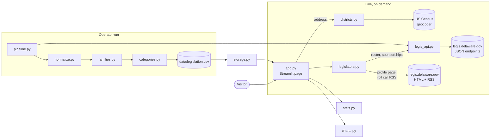

# Architecture

Your Delaware Legislators (v0.1.0) is a single Streamlit page. A visitor enters a Delaware address, or picks districts from a list, and sees their state senator and representative: contact details, legislative service, sponsorships and voting record, with links to the official records on legis.delaware.gov.

There is no database, separate API server or background worker. The page combines two kinds of data:

- **Live data**, fetched from legis.delaware.gov and the US Census geocoder when a visitor asks for it, then cached in memory by Streamlit.
- **A local copy of every bill in the session** (`data/legislation.csv`), built by an operator-run pipeline. It supplies what the live endpoints don't have: each bill's family (original, substitutes, amendments), its stage (did it pass?) and its topic.

## Data flow



### What happens when a visitor looks up an address

1. `districts.find_districts()` sends the address to the Census geocoder and gets back the Senate and House district numbers. The result is kept only in the visitor's session (see [address privacy](#address-privacy)).
2. `legislators.roster()` (cached for 24 hours) lists the member for every district. `find_seat()` picks the visitor's two seats, and `missing_districts()` warns if the roster has gaps.
3. For each legislator, the page fetches:
   - the **profile** (`fetch_profile`, cached 24 h): contact details, committees, years of service, photo
   - their **sponsorships** (`sponsored_legislation`, cached 1 h)
   - their **roll call votes** (`fetch_roll_calls`, cached 1 h)
4. `stats.sponsored_families()` maps each sponsorship onto a bill family from the CSV, so a bill and its substitutes count once and the strongest role wins. `sponsor_record()` and `vote_record()` produce the headline numbers, and `charts.category_outcome_bars()` draws the topic chart.

If any source fails, it is treated as **unavailable**, never as empty, so a failed fetch doesn't look like "no votes" or "no bills".

## Modules

| Module | Responsibility |
|---|---|
| `app.py` | The page: lookup form, legislator panels, error states, footer. Wraps each live fetch in `st.cache_data`. |
| `billtracker/districts.py` | Address → Senate and House district, via the Census geocoder. Rejects addresses outside Delaware. |
| `billtracker/legislators.py` | Roster, profile parsing (including the free-text years of service), sponsorship roles, roll call feed parsing with retries, next election date. |
| `billtracker/legis_api.py` | `LegisClient`: POSTs to the site's JSON grid endpoints, with retry and backoff. Used by both the page and the pipeline. |
| `billtracker/stats.py` | Pure-pandas aggregations: sponsored families, sponsor and vote records, outcomes by topic. |
| `billtracker/charts.py` | The one Altair chart: sponsored legislation by topic and outcome, in a colorblind-safe palette with light and dark variants. |
| `billtracker/storage.py` | Reads and writes `data/legislation.csv`. |
| `billtracker/pipeline.py` | CLI that downloads the whole session and writes the CSV. |
| `billtracker/normalize.py` | Raw API rows → tidy rows (dates, type, chamber, stage). |
| `billtracker/families.py` | Parses codes like `HA 1 to HS 1 for HB 233` to group substitutes and amendments with the original bill. |
| `billtracker/stages.py` | Maps the site's statuses to ordered stages, and defines which count as passed or dead. |
| `billtracker/categories.py` | Rule-based topics from keywords and the Delaware Code titles a bill amends. |
| `billtracker/config.py` | URLs, file paths, request timeout and headers. |

## Refreshing the bill data

The CSV is not refreshed from the page. Downloading the session takes several minutes and makes about 100 requests to legis.delaware.gov, so a public button for it would be an easy way to overload the state's site. An operator runs:

```bash
python -m billtracker.pipeline
```

The page uses the file's modification time as a cache key, so it picks up the new file on the next page load. Sponsorships newer than the CSV are flagged on the page rather than silently dropped.

## Address privacy

- The address is sent over HTTPS to the Census geocoder and nowhere else.
- It is **not** cached with `st.cache_data`, which would share it across visitors, and is not logged or written to disk.
- It stays in the visitor's Streamlit session (the form field and the matched result) until the session ends, shortly after the tab closes.

`tests/test_app.py` checks that two lookups of the same address both reach the geocoder, which would fail if a shared cache were added back.

## Tests

`pytest` runs everything offline:

- **Unit tests** for parsers, aggregations and the API client use small fixtures and fake sessions (`tests/conftest.py`, `tests/test_legislators.py`).
- **Page tests** (`tests/test_app.py`) run `app.py` with Streamlit's `AppTest`, against a fixture CSV with every network call stubbed. They cover error states, missing districts, address caching and the sponsorship numbers.
